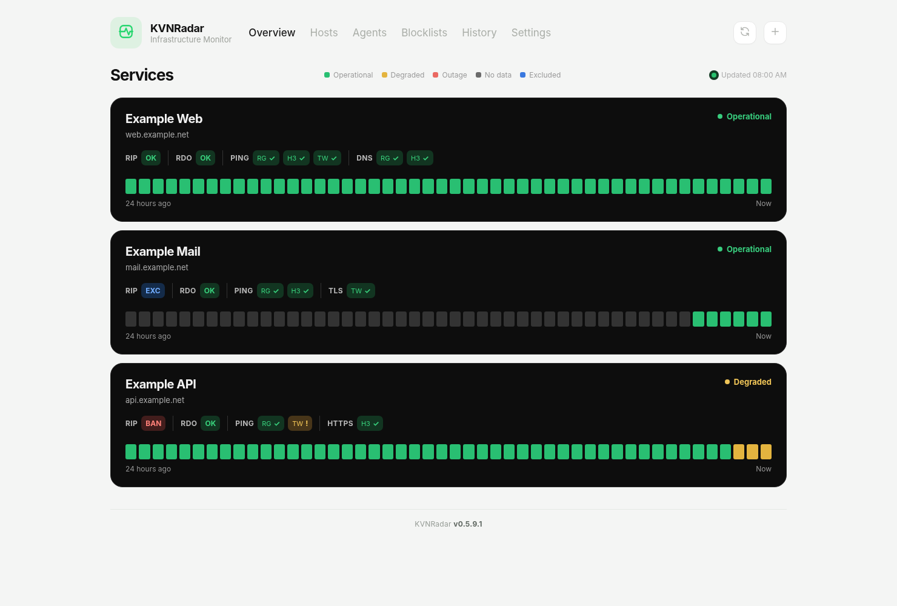
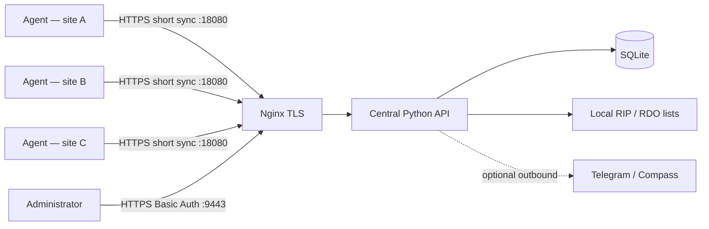

# KVNRadar



**Self-hosted distributed infrastructure for monitoring censorship blocks with independent network agents.**

KVNRadar monitors reachability, DNS resolution, TCP connectivity, TLS, HTTP(S) availability, content-transfer anomalies and network routes from multiple independent Linux locations. 
A central Python service coordinates lightweight Go agents, stores results in SQLite and provides a protected web dashboard. No VPN between agents and central is required.


---

## Contents

- [Features](#features)
- [Architecture](#architecture)
- [Requirements](#requirements)
- [Quick start](#quick-start)
- [Agent installation](#agent-installation)
- [Checks and status model](#checks-and-status-model)
- [Dashboard](#dashboard)
- [Notifications](#notifications)
- [Security](#security)
- [Configuration reference](#configuration-reference)
- [Building and testing](#building-and-testing)
- [Repository layout](#repository-layout)
- [Compatibility and limitations](#compatibility-and-limitations)
- [License](#license)

## Features

| Area | Capabilities |
|---|---|
| **Monitoring** | ICMP ping, DNS, TCP, TLS, HTTP, HTTPS, HTTP content transfer, traceroute |
| **Distributed** | Agents in separate locations/providers, each polling central for tasks, no incoming agent listener |
| **Central** | Python 3.13, SQLite persistence, agent tokens, resource and probe configuration, history |
| **Availability** | Status by probe and agent, recent measurement timeline, per-resource Overview |
| **Blocklists** | Central-only RIP (IP/CIDR) and RDO (domain) checks with independently downloaded local lists |
| **RIP exceptions** | Per-resource `rip_exempt` with distinct blue `EXC`; RDO still runs |
| **Notifications** | Optional Telegram Bot API and on-premises Compass Userbot; durable outbox |
| **Deployment** | Docker Compose central + Nginx TLS/basic authentication; Go agents via systemd |
| **Privacy** | Self-hosted status storage; blocklist provider requests do not include monitored hostnames |

## Architecture



## Requirements

- **Central:** Linux server, Docker Engine and Docker Compose v2, OpenSSL, Python 3 for bootstrap scripts, a domain with a trusted TLS certificate for production.
- **Agents:** Linux amd64 or arm64, systemd, `iputils-ping`, `traceroute`, CA certificates, outbound HTTPS to central on TCP 18080.
- **Building agents:** Go (version compatible with `agent/go.mod`; current source uses the standard library).
- **Network:** TCP **9443** for authenticated administration, **18080** for agent sync, optional **18081** to distribute agent binaries. Restrict administrative access by firewall/IP ACL.

## Quick start

```bash
# 1. Clone or unpack the source distribution
cd kvnradar

# 2. Prepare instance-only credentials/configs and a temporary certificate
sudo ./scripts/setup-central.sh

# 3. Replace certs/fullchain.pem and certs/privkey.pem with a trusted certificate
#    for your actual public hostname BEFORE production exposure.

# 4. Optional: set up notification integrations in .env
# 5. Start containers
sudo docker compose up -d --build
sudo docker compose ps
sudo docker compose logs --tail=100 central
```

`setup-central.sh` creates `.env`, `config/agents.json`, `config/targets.json`, `auth/users` and `certs/` **locally**, with strict file permissions. It generates random tokens for the five sample agent IDs and prompts for a dashboard password. These files are excluded by `.gitignore`. Replace the temporary 14-day self-signed certificate before allowing production clients to connect; agents verify certificates.

The initial legacy `targets.json` contains no example live targets. Add resources using **Hosts → Add** in the admin interface. To keep your own agent IDs, edit `config/agents.json` before deployment and generate a separate long random token for every agent.

**Administration:** `https://YOUR_HOST:9443/` (Basic Auth).

**Agent task sync:** `https://YOUR_HOST:18080/api/sync` (per-agent token).

**Optional binary distribution:** `https://YOUR_HOST:18081/agent/` (no agent tokens exposed).

Nginx TLS is configured in `deploy/nginx.conf`. On a shared host, confirm the published ports are not in use, and verify the Docker firewall/NAT policy. There is no need to expose 9443 broadly on the Internet.

## Agent installation

Build Linux binaries locally or on a build host:

```bash
./scripts/build-agents.sh
# dist/kvnradar-agent-linux-amd64
# dist/kvnradar-agent-linux-arm64
# agent-dist/ contains the binaries and SHA256SUMS for optional HTTPS distribution
```

On each monitored machine, use its own token from the central server's `config/agents.json` (never publish the full file). Example manual installation:

```bash
cp config/agent.example.json agent.json
# Edit agent, token, server (https://YOUR_HOST:18080)
sudo ./scripts/install-agent.sh dist/kvnradar-agent-linux-amd64 agent.json
sudo systemctl status kvnradar-agent
sudo journalctl -u kvnradar-agent -f
```

For ARM64 use `dist/kvnradar-agent-linux-arm64`. The standard service is **`kvnradar-agent.service`**. The agent binary is `/usr/local/bin/kvnradar-agent`, its config is `/etc/kvnradar/agent.json`, and persistent state is `/var/lib/kvnradar-agent`.

Alternatively, serve `agent-dist/` through port 18081, then on an agent:

```bash
# Download the bootstrap script securely, inspect it, then execute:
sudo bash install.sh --name example-agent \
  --server https://YOUR_HOST:18080 \
  --dist https://YOUR_HOST:18081/agent
```

The bootstrap prompts for the agent token without echoing it and verifies the downloaded binary against `SHA256SUMS`. The server URL and distribution URL **must** be adjusted for your installation; `radar.example.com` is a placeholder.

## Checks and status model

| Check | What it tests |
|---|---|
| PING | ICMP responsiveness |
| DNS | Resolver lookup |
| TCP | Establishing a TCP connection to a configured port |
| TLS | TLS handshake / connection checks |
| HTTP / HTTPS | Protocol reachability and HTTP status |
| DPI / Content | Received byte count, partial / truncated response, transfer anomalies |
| TRACE | Network route from each agent |
| RIP | IP addresses matched against central local IP/CIDR lists |
| RDO | Domain names matched against central local domain lists |

The central determines RIP/RDO statuses independently from the agents. `OK`, `BAN`, `EXC` (RIP-only) and unknown states are represented separately. **A blocklist match is an observation, not proof of a particular cause of network disruption.** RIP/RDO findings do not determine the service availability indicator.

The source automatically fetches blocklist feeds defined in `central/blocklists.py` (including antifilter.download). See source/configuration and ensure redistribution terms of external feeds are respected. Raw downloaded data is not part of this repository.

## Dashboard

The protected dashboard provides **Overview**, **Hosts**, **Agents**, **Blocklists** and **History**. Its native Overview shows enabled resources, per-agent probe results and a 24-hour availability timeline. Host configuration supports independent 
The admin interface requires HTTPS + HTTP Basic Auth. It does **not** provide MFA or multi-role authorization. Place it behind a firewall and preferably an IP allowlist or private administrative network.

## Notifications

Copy the sanitized template to `.env` (the setup script does this automatically). Supported variables:

```dotenv
COMPASS_BASE_URL=
COMPASS_BOT_TOKEN=
COMPASS_GROUP_ID=
TELEGRAM_TOKEN=
TELEGRAM_CHAT_ID=
TELEGRAM_API_BASE_URL=https://api.telegram.org
```

All notification credentials are optional. When configured, messages can include hostnames, IP addresses and incident details; sending to Telegram shares those fields with Telegram. `TELEGRAM_API_BASE_URL` can point to a compatible trusted HTTPS endpoint. Never commit real tokens; use `.env` only locally. Restart the central container after changes to `.env`.

## Security

- **Never commit:** `.env`, `agent.json`, `config/agents.json`, authentication hashes, `certs/`, SQLite databases, blocklist cache or runtime backups.
- **Use unique tokens** for each agent; do not reuse example placeholders.
- **Protect the dashboard** on 9443 with TLS, strong Basic Auth credentials and a network allowlist.
- **Use real certificates** before connecting agents; no automatic bypass of TLS validation.

## Configuration reference

| File / variable | Purpose |
|---|---|
| `.env.example` | Sanitized, documented optional notification and scan settings |
| `config/agents.example.json` | Sample IDs with nonworking placeholder tokens |
| `config/targets.example.json` | Empty initial legacy target manifest |
| `config/agent.example.json` | Sample single-agent configuration |
| `deploy/nginx.conf` | 9443 administration, 18080 agent API, 18081 optional binary distribution |
| `CENTRAL_BLOCKLIST_INTERVAL` | Central RIP/RDO scan interval, seconds (default 300) |
| `BLOCKLIST_UPDATE_SECONDS` | Local blocklist refresh interval, seconds (default 21600) |
| `BLOCKLIST_RESOLVE_DNS` | Optional DNS resolution in older list matching path (default 0) |

## Building and testing

```bash
python3 -m compileall -q central
node --check central/static/app.js
node --check central/static/private-overview.js
python3 -m unittest discover -s tests -p 'test_*.py'
./scripts/build-agents.sh
python3 tests/smoke.py
python3 scripts/check-release.py .
```

Node.js is needed only for the optional local JavaScript syntax check, **not** to run central or install KVNRadar. The smoke test runs the native Go probe tests using local HTTP fixtures and does not require a prebuilt agent binary.

## Repository layout

```text
kvnradar/
├── agent/                 Go agent source
├── agent-dist/            Optional secure agent bootstrap (generated binaries ignored)
├── central/               Python API, embedded admin interface, blocklist processing
│   └── static/            Dashboard JavaScript and CSS
├── config/                Sanitized configuration templates
├── deploy/                Nginx + native KVNRadar systemd unit
├── scripts/               Bootstrap, build, and release-audit scripts
├── tests/                 Unit and smoke tests
├── compose.yaml           Central + Nginx deployment
├── .env.example           Notification / tuning template; no real secrets
├── .gitignore             Exclusion of runtime data and credentials
└── README.md
```

## Compatibility and limitations
Agent checks reflect network conditions from their specific hosting providers, not every residential ISP. A partial transfer cannot by itself identify censorship, routing failures or a throttling policy.

## Languages and settings

KVNRadar provides an English-first admin UI with **English** and **Русский**.
Go to **Settings → Interface language** to switch languages. The choice is stored
in browser localStorage and does not affect agents or other administrators.

The **Settings → Runtime configuration** panel is read-only. The backend only
returns an explicit allowlist of non-sensitive runtime options and notification
availability. No tokens, passwords, API keys, chat/group identifiers, `.env`
contents, or private URL paths/query strings are returned. Settings are served
under the existing HTTPS Basic Auth protected `:9443` admin route.


## Agent short names

Each agent keeps its immutable technical ID for authentication, history and resource assignment.
KVNRadar automatically derives a **two-character uppercase label** from the first two
Latin letters of its ID (e.g. `digitalocean` → `DI`, `hetzner` → `HE`, `amazon` → `AM`).
Go to **Agents → Short name** to set an alternative two-character label (letters
or digits, e.g. `DI`, `HE`, `AM`). **Save** stores the override in SQLite;
**Auto** resets it to the automatically generated value. The same label appears
in Overview, Hosts, Agents and History. Existing IDs and API tokens are unchanged.
For newly added agents the label appears automatically after their first sync.
Manual duplicates are rejected; automatic duplicates can occur and should be
resolved by editing one of the agents.
