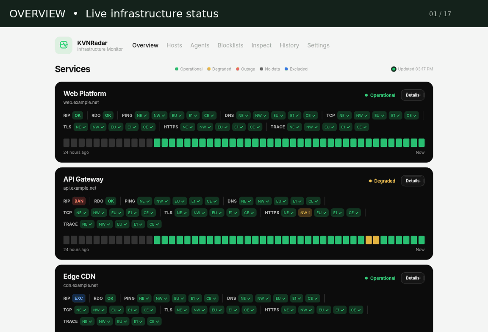
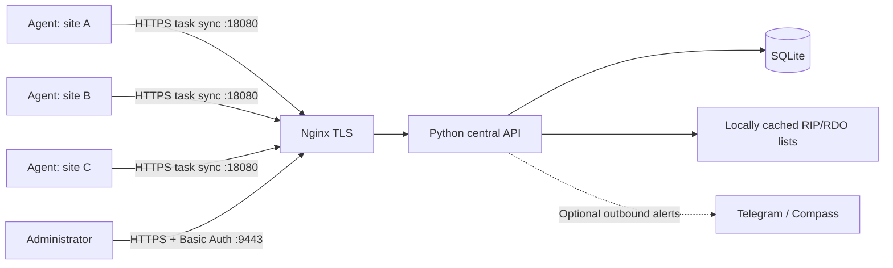
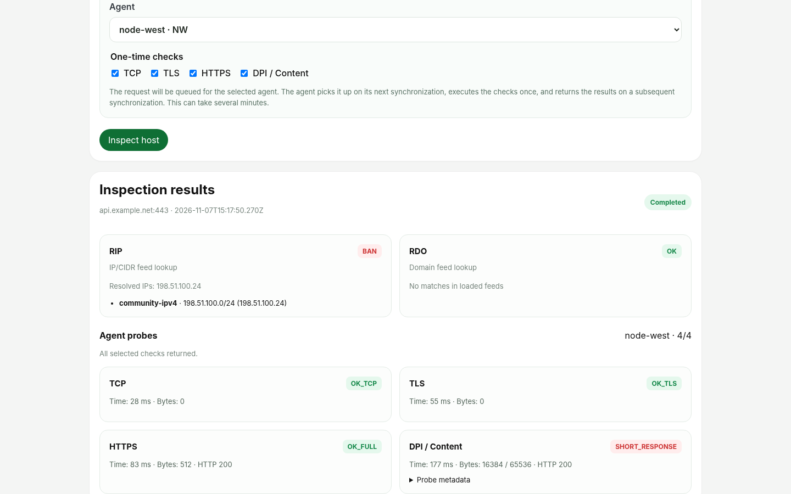

# KVNRadar



**Self-hosted distributed infrastructure monitoring and network-blocking diagnostics.**

KVNRadar monitors reachability, DNS resolution, TCP connectivity, TLS, HTTP(S), content-transfer anomalies and network routes from multiple independent Linux locations. A central Python service coordinates lightweight Go agents, stores results in SQLite and provides an authenticated web dashboard. Agents pull tasks from central; no VPN or inbound agent listener is required.


> **Source release:** Runtime credentials, certificates, live SQLite databases, downloaded blocklists and backups are not included. Generate credentials locally before deploying.

---

## Contents

- [Features](#features)
- [Architecture](#architecture)
- [Requirements](#requirements)
- [Quick start](#quick-start)
- [Agent installation](#agent-installation)
- [Dashboard](#dashboard)
- [Blocklist source management](#blocklist-source-management)
- [Inspect: on-demand diagnostics](#inspect-on-demand-diagnostics)
- [Screenshots](#screenshots)
- [Checks and status model](#checks-and-status-model)
- [Agent short names](#agent-short-names)
- [Languages and settings](#languages-and-settings)
- [Notifications](#notifications)
- [Configuration reference](#configuration-reference)
- [Security](#security)
- [Building and testing](#building-and-testing)
- [Repository layout](#repository-layout)
- [Compatibility and limitations](#compatibility-and-limitations)
- [License](#license)

## Features

| Area | Capabilities |
|---|---|
| **Distributed checks** | ICMP, DNS, TCP, TLS, HTTP/HTTPS, content-transfer diagnostics and traceroute from independent agents |
| **Monitoring lifecycle** | Add/edit hosts; pause or resume monitoring without deleting configuration or measurement history |
| **Overview** | Per-service state, RIP/RDO badges, agent-level check results, 24-hour timeline and **Details** dialog |
| **Blocklists** | Independently maintained RIP (IP/CIDR) and RDO (domain) feeds; add, edit, disable, update and delete sources in the dashboard |
| **RIP exclusions** | Per-resource `rip_exempt` produces blue `EXC` while retaining independent RDO checks |
| **Agents** | Two-character display labels generated automatically or overridden in **Agents** without changing agent IDs/tokens |
| **Inspect** | On-demand central RIP/RDO lookup for any hostname/IP; optional one-time TCP, TLS, HTTPS and DPI / Content probes via a selected agent |
| **Interface** | English by default, Russian selectable; read-only non-sensitive runtime Settings |
| **Notifications** | Optional Telegram Bot API and self-hosted Compass Userbot; persistent notification outbox |
| **Deployment** | Docker Compose central + Nginx TLS/Basic Auth; Go agents managed by systemd |
| **Privacy** | Local result storage and blocklist matching; monitored hostnames are not sent to blocklist-feed providers |

## Architecture



- Agents **pull** work and submit results; central does not initiate connections to agents.
- The native Overview is rendered inside the authenticated admin UI. **There is no separate public status page in the standard Compose deployment.**
- The web dashboard and the agent API use different listening ports and authentication mechanisms.

## Requirements

- **Central:** Linux, Docker Engine + Docker Compose v2, OpenSSL and Python 3 for bootstrap; a trusted HTTPS certificate for production.
- **Agents:** Linux amd64 or arm64 with systemd, `iputils-ping`, `traceroute`, CA certificates, and outbound HTTPS to the central service on TCP 18080.
- **Building Go agents:** compatible Go toolchain as specified in `agent/go.mod`.
- **Ports:** TCP 9443 for the admin panel, 18080 for agent task sync, and optionally 18081 for agent binary distribution. The standard Compose file does not publish 443.

## Quick start

Clone the repository, then prepare local credentials and start the central services:

```bash
git clone https://github.com/iskyneon/kvnradar.git
cd kvnradar

 # Creates local config, randomized example-agent tokens,
 # HTTP Basic Auth credentials and a temporary self-signed certificate.
sudo ./scripts/setup-central.sh

 # Before production use, replace certs/fullchain.pem and certs/privkey.pem
 # with a trusted certificate for your actual central hostname.
sudo docker compose up -d --build
sudo docker compose ps
sudo docker compose logs --tail=100 central
```

The setup script creates `.env`, `config/agents.json`, `config/targets.json`, `auth/users` and `certs/` locally, with restrictive permissions. It prompts for an admin username/password and generates a temporary **14-day** certificate. The initial `config/agents.example.json` defines **two example agent IDs** (`agent-a`, `agent-b`) whose placeholder tokens are replaced with random ones. You can add your own agent IDs and unique tokens to `config/agents.json`.

**Note:** The sample certificate uses `radar.example.com`. Install a certificate trusted by your agents and browsers for the actual hostname *before* connecting them. Certificate verification should not be disabled.

| Endpoint | Address | Authentication |
|---|---|---|
| Administrative UI | `https://YOUR_HOST:9443/` | HTTPS + HTTP Basic Auth (`auth/users`) |
| Agent sync | `https://YOUR_HOST:18080/api/sync` | Per-agent token |
| Optional agent distribution | `https://YOUR_HOST:18081/agent/` | Binary downloads / SHA256 checksums |

The `auth/users` file is created automatically by `scripts/setup-central.sh` and mounted into Nginx through `compose.yaml`. Never commit it. Restrict TCP 9443 with a firewall or IP allowlist where possible.

Once started, use **Hosts → Add host** to configure monitored resources. Initial example targets are not live production services.

## Agent installation

Build the agent binaries:

```bash
./scripts/build-agents.sh
# dist/kvnradar-agent-linux-amd64
# dist/kvnradar-agent-linux-arm64
```

On the target agent server, provide its configured ID and token from the central server's `config/agents.json`. The local installer uses a prepared JSON configuration and the matching binary:

```bash
cp config/agent.example.json agent.json
# Set: agent, token, server (https://YOUR_HOST:18080)
sudo ./scripts/install-agent.sh dist/kvnradar-agent-linux-amd64 agent.json
sudo systemctl status kvnradar-agent
sudo journalctl -u kvnradar-agent -f
```

Use `kvnradar-agent-linux-arm64` on ARM64 hosts. Installed paths:

| Component | Path |
|---|---|
| systemd service | `kvnradar-agent.service` |
| Executable | `/usr/local/bin/kvnradar-agent` |
| Agent configuration | `/etc/kvnradar/agent.json` |
| Pending results and state | `/var/lib/kvnradar-agent` |

To use remote installation, first build and serve `agent-dist/` via port 18081; download and review `agent-dist/install.sh`, then run:

```bash
sudo bash install.sh --name example-agent \
  --server https://YOUR_HOST:18080 \
  --dist https://YOUR_HOST:18081/agent
```

The remote installer prompts for the token without echoing it and validates the downloaded binary against `SHA256SUMS`. These are **new-install** scripts; they do not automatically migrate older LG1 Watch services. Never place agent tokens in the repository.

## Dashboard

The admin UI is a single native application with seven sections:

| Section | What you can do |
|---|---|
| **Overview** | View active service health, per-agent check results, RIP/RDO/EXC badges and a 24-hour timeline. Click **Details** on a service card to open its existing insights dialog: history, checks and latency information. |
| **Hosts** | Use **Add host** to create a resource. Search/filter hosts, edit checks and assigned agents, set the RIP exception, or **Pause monitoring / Resume monitoring**. Delete a host when no longer needed. |
| **Agents** | Inspect agent activity and assign custom two-character **Short names** or revert to **Auto**. |
| **Inspect** | Check any hostname or IP instantly against cached central RIP/RDO lists; optionally queue one-time TCP, TLS, HTTPS and DPI / Content checks for one selected agent, then view the correlated results. |
| **Blocklists** | Manage downloaded IP/CIDR and domain sources, see source health, update time, record counts and current matches. |
| **History** | Filter and inspect recorded measurements by resource. |
| **Settings** | Switch English/Russian and inspect an allowlisted, read-only runtime configuration summary. |

**Pause vs delete:** Pausing sets `resources.enabled=false` and stops scheduling checks for that resource, including central RIP/RDO scans. The resource, check configuration, RIP exception setting and existing measurement history remain in SQLite. Resume enables monitoring again. The Overview intentionally shows active resources; paused resources remain manageable under Hosts → Disabled.

**Details moved in v0.6.4:** Open the existing Details dialog from the **Overview** card, not from the Hosts action row. The dialog is linked to the resource's technical ID rather than its display name.

## Blocklist source management

Blocklist source settings are stored in **SQLite**, not in `.env` or a hardcoded Python source list. The Blocklists editor supports:

- **Add source** — supply a unique source ID, feed type (`Domain` or `IP/CIDR`) and HTTPS feed URL.
- **Edit** — change the source definition and enabled state.
- **Enable / Disable** — exclude a feed temporarily without deleting its configuration.
- **Update now** — request an immediate feed refresh.
- **Delete** — remove a feed from the active configuration.

The initial Antifilter domain/CIDR sources are inserted on first migration, and then treated as editable sources. A deleted source is not recreated at each restart. The central scanner combines all enabled cached feeds of each type. A failed refresh retains the previously downloaded valid data; the source displays an error. Source changes trigger central checking without waiting for the next regular scan.

**Fetch restrictions:** only HTTPS feeds on port 443, with validation of public destination IPs. The downloader rejects local/private destinations, URL credentials and redirects; environment HTTP proxies are not used. The response size is capped at 256 MiB. Source URLs must therefore be publicly reachable HTTPS endpoints; an internal-only feed is not supported by this downloader.

**Data privacy:** KVNRadar downloads feed files and performs membership checks locally. It does **not** send monitored resource names or IPs as feed lookup requests. A host's normal DNS queries may still leave the configured resolver.

## Inspect: on-demand diagnostics

**Inspect** (`#inspect`, introduced in **v0.6.5**) lets an administrator diagnose an arbitrary **hostname or IP address without adding it to Hosts or changing existing monitoring**.

1. Open **Inspect**, enter a hostname/IP and the target port (`443` by default), then select **Inspect host**.
2. The central server immediately checks the host against **locally cached, enabled RIP (IP/CIDR) and RDO (domain) feeds**. Results include `OK`, `BAN` or `UNKNOWN`, matched sources/CIDRs/domains and resolved IP addresses when available. Inspect does **not** refresh external feeds for each request.
3. Optionally enable **Run one-time probes from a selected agent**, choose a configured agent and one or more of **TCP**, **TLS**, **HTTPS** and **DPI / Content**. The chosen port is used for these probes. HTTPS and DPI use HTTPS path `/`; DPI / Content expects **64 KiB** by default.
4. The inspection is queued in central SQLite. The agent **pulls** the one-time task through its regular `/api/sync` session and returns its structured results on a subsequent sync. The UI displays **Queued → Sent to agent → Completed**, or **Timed out** when the job expires. This may take several minutes depending on the agent sync interval (often 300 seconds); it is not an immediate inbound connection from central to an agent.
5. When available, the result shows each check's status, duration, received/expected bytes, HTTP status, errors and probe metadata. The page also displays the **15 most recent inspection requests**.

> **Isolation:** Inspect uses unique job IDs to associate results with the correct request. Its measurements are held separately from ordinary availability history; one-time Inspect tests do **not** alter existing Hosts, availability timelines, incidents or Telegram/Compass notifications. Existing compatible Go agents require no new incoming ports.

Agent jobs expire after **30 minutes**. An agent can have at most **three** pending inspection requests, preventing the one-shot queue from growing without limit. A `BAN` match is a blocklist observation, not proof of censorship or a failed network connection. The selected remote probe checks actual connectivity from **that agent's location**, which can differ from central.

### Inspect screenshots



[Inspect form](assets/screenshots/10-inspect.png) · [Agent and test selection](assets/screenshots/11-inspect-agent-options.png) · [Queued](assets/screenshots/12-inspect-queued.png) · [Sent to agent](assets/screenshots/13-inspect-sent.png) · [Completed](assets/screenshots/14-inspect-results.png)

## Screenshots

The animated product tour above is made from browser captures of the **actual v0.6.5 admin UI using synthetic demo data**, not a live production deployment.

| Section / capability | Screenshot |
|---|---|
| Overview | [Status cards and RIP/RDO](assets/screenshots/01-overview.png) |
| Resource Details | [Latency, events and check history](assets/screenshots/02-resource-details.png) |
| Hosts | [Host list](assets/screenshots/03-hosts.png) · [Pause / Resume](assets/screenshots/04-host-controls.png) · [Add host](assets/screenshots/05-add-host.png) |
| Agents | [Agent status and short names](assets/screenshots/06-agents.png) |
| Blocklists | [Source health](assets/screenshots/07-blocklists.png) · [Add source](assets/screenshots/08-add-source.png) · [Edit source](assets/screenshots/09-edit-source.png) |
| Inspect | [Form](assets/screenshots/10-inspect.png) · [Agent checks](assets/screenshots/11-inspect-agent-options.png) · [Queued](assets/screenshots/12-inspect-queued.png) · [Dispatched](assets/screenshots/13-inspect-sent.png) · [Results](assets/screenshots/14-inspect-results.png) |
| History | [Recorded measurements](assets/screenshots/15-history.png) |
| Settings | [Read-only configuration and language](assets/screenshots/16-settings.png) · [Russian UI](assets/screenshots/17-russian.png) |

## Checks and status model

| Check | What it tests |
|---|---|
| PING | ICMP responsiveness |
| DNS | DNS lookup from agent locations |
| TCP | TCP connection to the configured host/port |
| TLS | TLS connection/handshake |
| HTTP / HTTPS | HTTP service reachability and status |
| DPI / Content | Content transfer amount, truncation and short-response anomalies |
| TRACE | Traceroute from agent locations |
| RIP | Central IP/CIDR feed matches for the host or its resolved IP addresses |
| RDO | Central domain feed matches |

RIP and RDO execute centrally, separately from agents, and Inspect can query those cached lists on demand. They can show `OK`, `BAN` or an unknown state; RIP additionally supports blue `EXC` when `rip_exempt` is enabled. **A blocklist match is a diagnostic observation, not evidence by itself of censorship or a specific connectivity failure.** RIP/RDO findings do not change availability (`Healthy`, `Degraded`, `Outage`, `No data`).

HTTP and HTTPS destinations are configured per check, including ports and paths. Checks can be enabled or disabled independently on each host.

## Agent short names

Each agent has an immutable technical ID used for authentication, assignments and history. KVNRadar automatically derives a **two-character uppercase display label from the first two Latin letters** of the ID. For example, `hetzner` → `HE`, `edge-west` → `ED` and `node-1` → `NO`.

Under **Agents → Short name**, enter a custom two-character label and click **Save**, or click **Auto** to restore the generated label. Manual duplicates are rejected; automatic duplicates may still occur and can be resolved by customizing one of them. The short label appears across the dashboard but does not change the agent ID or token.

## Languages and settings

English is the default dashboard language. The language selector under **Settings → Interface language** offers **English** and **Русский**. The choice is stored in the current browser's localStorage, and changing it does not change other administrators' settings.

The **Settings → Runtime configuration** panel is read-only. It shows a restricted set of non-secret values and whether supported notification integrations are configured. It does not expose `.env` contents, agent tokens, authentication passwords, API keys, group/chat identifiers or private URL paths/query parameters.

## Notifications

Optional Compass Userbot and Telegram integrations can send incident messages. Configure these in the local `.env`:

```dotenv
COMPASS_BASE_URL=
COMPASS_BOT_TOKEN=
COMPASS_GROUP_ID=
TELEGRAM_TOKEN=
TELEGRAM_CHAT_ID=
TELEGRAM_API_BASE_URL=https://api.telegram.org
```

When configured, messages may contain hostnames, IP addresses and incident details. Sending to Telegram exposes those fields to the configured Telegram infrastructure. `TELEGRAM_API_BASE_URL` may be set to a trusted compatible HTTPS endpoint. Do not store actual notification credentials in GitHub. Restart `central` after modifying `.env`.

## Configuration reference

| Setting | Purpose |
|---|---|
| `.env.example` | Non-secret template for optional notifications and tuning; copy to `.env` locally |
| `config/agents.example.json` | Sample agent IDs with dummy tokens; local setup generates real tokens |
| `config/agent.example.json` | Single-agent configuration template |
| `config/targets.example.json` | Legacy initial target manifest; use Hosts in the UI to configure resources |
| `deploy/nginx.conf` | Nginx TLS, Basic Auth and agent distribution endpoints |
| `CENTRAL_BLOCKLIST_INTERVAL=300` | Regular central RIP/RDO matching interval, in seconds (minimum 60) |
| `BLOCKLIST_UPDATE_SECONDS=21600` | Remote blocklist download interval, in seconds (minimum 900) |
| `BLOCKLIST_RESOLVE_DNS=0` | DNS resolving in the additional Blocklist Hits path; **does not** disable resolution by the main RIP/RDO scanner |

**Important:** `BLOCKLIST_RESOLVE_DNS` applies only to the auxiliary `blocklist_hits` matching path. The main RIP check has its own DNS-resolution behavior. Source URLs are edited in **Blocklists**, not through `.env`.

## Security

- **Keep private:** `.env`, `auth/users`, `config/agents.json`, per-agent `agent.json`, `certs/privkey.pem`, SQLite databases, cached blocklists and backups.
- Use a **different long random token for every agent**. A display short name never becomes an authentication identity.
- Protect the admin service on TCP **9443** using HTTPS, Basic Auth and, preferably, firewall/IP restrictions. The dashboard has no MFA or separate user roles.
- Use trusted TLS certificates for both browser and agent connections; do not disable peer verification in production.
- Remember that optional notification integrations send incident fields to their configured destination.
- The standard deployment does not publish a public status page; do not expose a separate unauthenticated deployment inadvertently.

## Building and testing

```bash
python3 -m compileall -q central
node --check central/static/app.js
node --check central/static/private-overview.js
python3 -m unittest discover -s tests -p 'test_*.py'
./scripts/build-agents.sh
python3 tests/smoke.py
python3 scripts/check-release.py .
```

Node.js is needed for optional local syntax checking only; it is **not** required to run the central container or to install an agent. The smoke tests run local fixtures; they do not verify real-world network censorship behavior.

## Repository layout

```text
kvnradar/
├── agent/                 Go agent source
├── agent-dist/            Optional HTTPS agent installation and generated distribution files
├── central/               Python API, dashboard, blocklist download and matching
│   └── static/            CSS, JavaScript, localization and native Overview
├── config/                Sanitized configuration templates
├── deploy/                Nginx and systemd service files
├── scripts/               Bootstrap, build and release-audit scripts
├── tests/                 Unit and smoke tests (including Inspect)
├── assets/                Screenshots and product-tour GIF
├── compose.yaml           Central + Nginx deployment
├── .env.example           Environment template (no secrets)
├── .gitignore             Runtime / credential exclusions
└── README.md
```

## Compatibility and limitations

- Agent results represent the specific networks where agents run, not the availability from every ISP or country.
- Partial HTTP transfers, DNS failures or RIP/RDO matches are indicators requiring further investigation, not definitive identification of a blocking mechanism.
- A fresh installation requires credentials, a valid HTTPS certificate and manual configuration of monitored hosts and agent IDs.
- Legacy agent/service names are not automatically migrated by the new-install scripts.

## License

No `LICENSE` file is currently included in the repository. Choose and add a license before representing this project as having open-source reuse rights. Publishing source code alone does not grant a general license to reuse or redistribute it.
